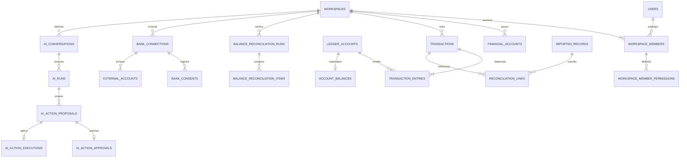

# FINANCE AI — Modelo inicial do banco de dados

Data: 23/11/2026. Estado: modelo lógico proposto; não contém migrations executáveis.

## 1. Status e convenções

**DECISÃO APROVADA:** PostgreSQL no Supabase, RLS, migrations versionadas e auditoria; D01 inclui gestão pessoal, familiar e empresarial, investimentos e projeções; D02 define os três espaços, colaboração e permissões; D03 define partidas dobradas, correções por estorno e novo lançamento, confirmação automática após validações, saldos armazenados e integridade.

**DECISÃO APROVADA — D04:** pnpm workspaces (D04.1), Supabase SDK (D04.2), funções transacionais PostgreSQL nas operações financeiras críticas (D04.3) e ausência inicial de ORM, passível de reavaliação futura (D04.4).

**DECISÃO APROVADA — D05.1:** a aplicação Next.js será hospedada inicialmente na Render; o banco permanece no Supabase PostgreSQL. Desenvolvimento local não exige contratação de hospedagem; produção usa instância paga Render dimensionada por testes de desempenho, segurança e capacidade, sem plano comercial específico aprovado. Isolamento, autenticação, autorização, proteção dos dados e possibilidade de evolução/migração da hospedagem são preservados.

**DECISÃO APROVADA — D05.2: arquitetura principal:** Supabase Queues (pgmq) para persistência e entrega das tarefas, Render Background Worker separado do Next.js para execução e Supabase Cron para disparos periódicos. Entrega pelo menos uma vez exige idempotência persistente, revalidação de permissões e escopo, mensagens mínimas, auditoria e recuperação de falhas, preservando D03/D04 e a autorização explícita da IA.

**DECISÃO APROVADA — D06:** importação OFX/CSV e cadastro manual no lançamento, com prévia, seleção, confirmação e rastreabilidade; processamento parcial recuperável de lotes, atomicidade por operação financeira e idempotência persistente. Integração bancária futura usa contrato normalizado/versionado, IDs internos estáveis e referências externas separadas. Essas decisões não aprovam automaticamente tabelas, campos ou índices.

**DECISÃO APROVADA — D09:** o ciclo de retenção e exclusão é definido por categoria. **PROPOSTA TÉCNICA:** associar cada categoria do modelo ao inventário de finalidades, papéis e bases legais. Registrar a versão da política e o atendimento de pedidos de titulares com evidência mínima e acesso restrito. Avaliar separadamente identificadores pessoais, arquivos importados, ledger, conversas, auditoria e backups. A exclusão deve conciliar direitos, obrigações de guarda e integridade do ledger, preservando o isolamento por workspace. Os prazos e as bases legais definitivas permanecem pendentes.

**PROPOSTA TÉCNICA:** tabelas, campos, tipos, cardinalidades, índices e detalhes físicos abaixo continuam propostas até a fase de implementação. A escolha de funções transacionais está aprovada, mas seus contratos, assinaturas e mecanismos de concorrência não estão definidos. As decisões orientam o modelo sem aprovar seu desenho físico completo. **PENDÊNCIA DE DECISÃO:** parâmetros operacionais da D05.2, demais detalhes não decididos da D05, detalhamentos pendentes da D06 e condições comerciais da D07, parâmetros da D08, detalhamentos da D09 e decisões D10–D12 e demais pontos do [registro de arquitetura](architecture.md#8-registro-de-decisões).

Convenções propostas:

- PK `id` em UUID, salvo vínculo de perfil com identidade Supabase.
- Tabelas de negócio têm `workspace_id` obrigatório, `created_at` e, quando mutáveis, `updated_at` e `version` para concorrência otimista.
- Instantes em `timestamptz`, armazenados em UTC; competência, vencimento e data financeira em `date`. Fuso IANA do workspace é explícito; sugestão inicial America/Sao_Paulo, editável, sem presumir um único fuso para todo o Brasil.
- Valores em `numeric(20,2)` para BRL e taxas em precisão decimal maior definida pelo caso de uso. Transporte de decimais como string; não calcular dinheiro com ponto flutuante binário de JavaScript.
- Moeda explícita, inicialmente restrita a BRL. Suporte futuro a câmbio exige decisão e novo modelo; uma coluna de moeda não implementa multimoeda.
- FKs com escopo: toda referência entre entidades de negócio usa `(workspace_id, entidade_id)` para uma chave única correspondente. Isso impede referências entre workspaces mesmo quando IDs são conhecidos.
- Exclusão de pai financeiro referenciado é restrita; arquivamento não deve ocultar valores de relatórios históricos. Exclusão/anônimização por privacidade segue política específica, não um soft delete universal.
- Campos de identificação fiscal só são coletados quando necessários, com proteção e finalidade definidas. JSON não substitui relacionamentos ou restrições essenciais.

## 2. Identidade, espaços e planos

**DECISÃO APROVADA — D07:** assinatura independente por workspace. Planos, recursos, preços e limites são configuráveis e versionados. O histórico de assinaturas, planos e pagamentos deve ser auditável e separado do razão financeiro do cliente.

**PROPOSTA TÉCNICA:** vincular cada período da assinatura à versão do plano aplicável. Registrar início e fim do teste gratuito de 7 dias e a autorização de cobrança separadamente. Manter referências externas, eventos autenticados e evidências de cancelamento, renovação, mudança de plano, estorno ou contestação em registros restritos de cobrança. Aplicar evento e registrar seu resultado de forma idempotente, com conciliação após falhas. Uma mudança comercial não apaga dados financeiros nem altera saldos. Tabelas, campos, transições e prazos comerciais continuam sujeitos a detalhamento.

| Entidade | Campos principais | Relações e invariantes |
|---|---|---|
| auth.users | Identidade gerenciada pelo Supabase | Credenciais ficam no Auth, não em tabelas próprias |
| profiles | id → auth.users, display_name, locale | Uma identidade possui no máximo um perfil; sem senha ou token bancário |
| workspaces | id, kind personal/family/business, name, owner_user_id, currency, timezone, status | Pessoal privado e sem convidados; familiar e empresarial compartilhados; proposta de no máximo um pessoal ativo por proprietário |
| workspace_members | workspace_id, user_id, role, status | Único por workspace/usuário; proprietário deve possuir associação owner ativa |
| workspace_invitations | workspace_id, email_normalized, role, token_hash, expires_at, accepted_at | Token de uso único; aceitação exige identidade correspondente; não permite convite owner |
| workspace_member_permissions | workspace_id, member_user_id, area, action, effect | FK composta para associação; granularidade empresarial; catálogo e precedência ainda propostos |
| ownership_transfers | workspace_id, current_owner_id, proposed_owner_id, authorized_at, accepted_at, expires_at, state | Evidência da autorização do owner atual e aceitação do novo; efetivação atômica |
| family_copy_requests | destination_workspace_id, requested_by, source_ref_restricted, selected_payload, idempotency_key, state, destination_record_id | Operação controlada de cópia pessoal → familiar; metadados da origem nunca expostos aos membros do destino |
| business_profiles | workspace_id, legal_name, trade_name, tax_id protegido opcional | Relação 0..1 com workspace; permitido somente para business |
| plans | id, code, version, status, limits | Catálogo global, leitura controlada; cliente não altera preço/limites |
| subscriptions | workspace_id, plan_id, provider, external_id, status, period_end | No máximo uma assinatura corrente por workspace; referência externa única por provedor |
| billing_events | workspace_id, provider, external_event_id, payload_ref, state | Evento externo único por provedor; escrita apenas pelo processamento confiável |
| usage_counters | workspace_id, metric, period_start, quantity | Único por workspace/métrica/período; incrementos atômicos |

**DECISÃO APROVADA — D02:** pessoal sem convidados; convites individuais por e-mail, com validade, uso único e aceitação obrigatória; remoção revoga imediatamente o acesso e preserva registros e auditoria. Transferência de propriedade exige autorização do owner atual e aceitação do novo. Somente owner administra assinatura; não há exigência geral de dupla aprovação financeira.

**PROPOSTA TÉCNICA:** em espaços compartilhados, transferência aceita atualiza `owner_user_id` e papéis em uma transação, sem deixar o espaço sem owner e revalidando identidades e associações. Transferência de um espaço pessoal não deve converter privacidade individual em colaboração; fluxo aplicável ao pessoal permanece sem definição. Regras entre tabelas requerem operações transacionais e validação no banco. Remoção desativa a associação em vez de apagar sua evidência histórica; operações comuns, jobs delegados e IA verificam associação/permissões atuais.

### Cópia pessoal para familiar

**DECISÃO APROVADA:** cópia independente, original privado, sem sincronização automática. Não é transferência direta entre workspaces.

**PROPOSTA TÉCNICA:** serviço de cópia verifica acesso à origem e permissão de criar no destino; cria novos IDs, mapeia contas/categorias do destino e não reutiliza FKs pessoais. `family_copy_requests` fica em área operacional restrita, com referência de origem disponível somente ao solicitante autorizado/processador. Registros familiares, auditoria compartilhada e anexos não podem oferecer navegação para o original privado. Uma chave idempotente impede repetir a mesma solicitação. Se o registro copiado for um lançamento, passa pelas validações e atualização atômica do saldo do destino, sem qualquer débito/crédito no espaço de origem.

**PENDÊNCIA DE DECISÃO:** campos e anexos copiáveis, semântica de inclusão em relatórios familiares e prevenção de dupla representação econômica dentro do destino. A aprovação da cópia não aprova replicar tokens, consentimentos, documentos integrais ou relações privadas.

## 3. Núcleo financeiro

**DECISÃO APROVADA — D03:** razão interno de partidas dobradas para os três contextos, com débitos/créditos equilibrados em cada lançamento confirmado e rastreabilidade sem escrituração contábil oficial. Saldos são armazenados e atualizados diretamente a cada movimentação confirmada; o razão permite conciliá-los e reconstruí-los. **PROPOSTA TÉCNICA:** entidades abaixo materializam essas regras, sem implementar tabelas.

| Entidade | Campos principais | Relações e invariantes |
|---|---|---|
| ledger_accounts | workspace_id, name, class, currency, status | Classes asset/liability/equity/income/expense; pertence a um workspace |
| financial_accounts | workspace_id, ledger_account_id, name, kind, institution, masked_identifier | Relação 1:1 com conta patrimonial; saldo armazenado em account_balances e reconstruível por itens confirmados |
| account_balances | workspace_id, ledger_account_id, currency, debit_total, credit_total, balance, version, updated_at | Uma linha por conta/moeda; atualização na mesma transação da confirmação, inclusive estornos |
| balance_reconciliation_runs | workspace_id, cutoff, state, started_at, finished_at, initiated_by | Conciliação periódica de saldos armazenados com o razão em corte consistente |
| balance_reconciliation_items | workspace_id, run_id, ledger_account_id, stored_balance, computed_balance, difference, resolution_ref | Divergências rastreadas; reparo autorizado e auditado sem editar lançamentos confirmados |
| categories | workspace_id, parent_id opcional, name, kind, ledger_account_id | Hierarquia no mesmo espaço, sem ciclos; referência a receita/despesa compatível |
| transactions | workspace_id, kind, status, occurred_on, competence_on, description, source, reversal_of_id, replaces_transaction_id, correction_reason, idempotency_key, created_by, confirmed_at | Estados propostos draft/pending/rejected/posted; confirmado imutável; autoria e justificativa de correção preservadas |
| transaction_entries | workspace_id, transaction_id, ledger_account_id, side, amount, category_id opcional, cost_center_id opcional | Valor positivo; lado debit/credit; soma de débitos igual a créditos por lançamento |
| cost_centers | workspace_id, name, status | Somente workspace empresarial; centro arquivado continua consultável no histórico |
| counterparties | workspace_id, name, kind, tax_id opcional protegido | Cliente/fornecedor/outro; dados mínimos necessários |
| obligations | workspace_id, kind payable/receivable, counterparty_id, amount, due_on, competence_on, recurrence_rule_id opcional | Compromisso previsto; não altera saldo bancário por si só |
| obligation_settlements | workspace_id, obligation_id, transaction_id, amount | N:M entre obrigações e lançamentos; suporta liquidação parcial; total não excede obrigação sem regra explícita |
| recurrence_rules | workspace_id, template, frequency, next_due_on, ends_on, status | Gera compromissos ou rascunhos; único por regra/ocorrência para evitar duplicação |
| budgets | workspace_id, category_id, period_start, period_end, limit_amount | Valores não negativos; política de sobreposição definida antes de implementar |
| goals | workspace_id, name, target_amount, target_date, status | Metas pessoais/familiares; progresso derivado de alocações, sem inventar saldo |
| goal_allocations | workspace_id, goal_id, financial_account_id, amount | Reserva virtual; não é movimentação; soma por conta limitada ao disponível sob política aprovada |

### Invariantes de postagem

**DECISÃO APROVADA — D04.3:** operações financeiras críticas usam funções transacionais PostgreSQL. **PROPOSTA TÉCNICA:** postagem, correção por estorno/novo lançamento e atualização de saldos passam por funções restritas chamadas via Supabase SDK/RPC, preservando uma unidade transacional por operação. Não coordenar gravações independentes do SDK como substituto dessa transação. Validar identidade, workspace, permissões, idempotência, balanceamento e auditoria no caminho de execução; RLS e restrições continuam aplicáveis conforme o papel efetivo. Nomes e desenho das funções permanecem propostas; nenhum SQL executável é criado aqui.

**DECISÃO APROVADA:** lançamentos válidos são confirmados automaticamente após as validações. Inválidos, incompletos ou suspeitos de duplicidade são rejeitados ou mantidos pendentes e não alteram saldos confirmados. Autorização explícita para alterações da IA continua obrigatória; validação de dados não substitui autorização.

**PROPOSTA TÉCNICA:** postagem atômica engloba cabeçalho, no mínimo dois itens, balanceamento, moeda, vínculos/permissões do workspace, deltas em `account_balances`, auditoria e eventual outbox. A transição para `posted` ocorre junto com essas gravações, sem estado intermediário visível. Chave única de idempotência por workspace/operação impede aplicar duas vezes o lançamento ou seus deltas. Conteúdo diferente sob a mesma chave é conflito. Serialização/bloqueio das contas em ordem estável ou versão otimista são alternativas ainda a validar para concorrência. Inserção direta de itens/saldos pela API pública deve ser bloqueada; balanceamento entre linhas exige mecanismo transacional, não só check de linha.

**DECISÃO APROVADA:** lançamentos confirmados não são editados nem apagados pela operação normal; correção ocorre por estorno e novo lançamento, preservando autoria, justificativa e histórico. **PROPOSTA TÉCNICA:** inverso ligado por `reversal_of_id` e novo registro ligado por `replaces_transaction_id`; proteger contra estorno duplicado. Original, inverso e novo lançamento permanecem rastreáveis; cada efeito confirmado atualiza o saldo uma única vez. Executar a correção como unidade transacional. Saldo inicial é lançamento explícito contra conta de abertura.

Exemplos conceituais: recebimento debita banco e credita receita; pagamento debita despesa e credita banco; transferência debita conta de destino e credita conta de origem dentro do mesmo workspace. **DECISÃO APROVADA:** transferência interna não gera receita/despesa; não existe transferência direta entre workspaces. A cópia pessoal/familiar é uma operação distinta de compartilhamento de registros, sem transferência financeira nem vínculo sincronizado.

Saldos de ativos usam débitos menos créditos; passivos usam créditos menos débitos. Relatórios distinguem fluxo de caixa e competência e não somam transferências internas como receita/despesa. Regras finais de reconhecimento, arredondamento, parcelas, fechamento e ajustes dependem de D11.

### Conciliação e reconstrução dos saldos

**DECISÃO APROVADA:** conciliação periódica e possibilidade de reconstrução a partir dos lançamentos confirmados. **PROPOSTA TÉCNICA:** comparar saldo armazenado com somatório do razão em snapshot/corte consistente, registrar diferenças e alertar. Evitar comparar instantes distintos enquanto há lançamentos concorrentes. Reconstrução calcula em área temporária lógica e substitui o saldo de forma atômica, com exclusão de concorrência ou reaplicação controlada de deltas posteriores ao corte. Não modificar o razão para esconder divergência nem gerar nova movimentação para corrigir mero erro do saldo materializado. Autorizar e auditar reparo operacional; o detalhe do mecanismo e a periodicidade continuam pendentes.

### Investimentos e projeções

**DECISÃO APROVADA — D01:** gestão de investimentos e projeções integra o produto, sem ordens de investimento. **PROPOSTA TÉCNICA:** registros de posições/ativos, avaliações com data e fonte e cenários com premissas/método versionado devem ser isolados por workspace e relacionados às contas autorizadas. Quantidades, preços e rentabilidades podem exigir precisão superior à de BRL monetário. Não confundir valorização estimada com saldo disponível nem duplicar aportes/resgates já registrados no razão. **PENDÊNCIA DE DECISÃO:** instrumentos cobertos, fontes de cotação, regras de valorização, métodos de projeção e entidades finais; nenhuma tabela física desse módulo está aprovada.

## 4. Cartões e faturas

| Entidade | Campos principais | Relações e invariantes |
|---|---|---|
| credit_cards | workspace_id, liability_account_id, name, last_four, closing_day, due_day, limit_amount | Vinculado a passivo; sem PAN completo ou CVV |
| card_invoices | workspace_id, credit_card_id, reference_period, closes_on, due_on, status | 1:N cartão/faturas; período único por cartão |
| card_purchases | workspace_id, credit_card_id, purchased_on, total_amount, installment_count | Uma compra possui uma ou mais parcelas |
| card_installments | workspace_id, purchase_id, invoice_id, installment_number, amount, transaction_id opcional | Número único por compra; soma das parcelas igual ao total; parcela postada tem lançamento associado |
| card_invoice_payments | workspace_id, invoice_id, transaction_id, amount | Liquidação parcial ou total; não criar nova despesa ao pagar passivo |

**PROPOSTA TÉCNICA:** cada parcela reconhecida debita despesa e credita o passivo do cartão; pagamento debita passivo e credita banco. Compra é metadado e compromisso total; não gerar simultaneamente despesa integral e despesas das parcelas. Distribuição de centavos usa regra determinística, com ajuste residual definido em D11. Conciliação deve reconhecer a mesma compra nos dados do cartão e o pagamento no extrato bancário sem duplicar despesas.

## 5. Open Finance, importações e processamento

**DECISÃO APROVADA — D06:** arquivo, observação importada e lançamento financeiro devem ser rastreáveis. A preparação e a prévia não alteram saldos. O usuário confirma o conjunto selecionado; permissões e condições financeiras são revalidadas antes do registro. A operação financeira confirma atomicamente ledger, saldos e auditoria, com idempotência persistente; o lote admite conclusão parcial e retomada.

Saldos iniciais são identificáveis e balanceados, sem classificação automática como receita. Transferências internas não geram receita/despesa; pagamentos de faturas não repetem as despesas das compras. Ambiguidades permanecem sem classificação definitiva até resolução autorizada. Confirmados são corrigidos exclusivamente por estorno e novo lançamento.

**PROPOSTA TÉCNICA — distinção de modelos:** as entidades abaixo representam um modelo lógico, não migrations aprovadas. Conexões, consentimentos e sincronizações com provedores são destinados à integração futura. Contas manuais e importações de arquivos não dependem da existência de conexão bancária ou consentimento Open Finance.

| Entidade | Campos principais | Relações e invariantes |
|---|---|---|
| bank_connections | workspace_id, provider, external_connection_id, status, secret_ref, last_synced_at | Conexão pertence a um único workspace; segredo fica fora da API de dados |
| bank_consents | workspace_id, connection_id, external_consent_id, scopes, status, granted_at, expires_at, revoked_at | Histórico de consentimentos; renovação não apaga evidências anteriores |
| external_accounts | workspace_id, connection_id, external_account_id, financial_account_id opcional | Conta externa mapeada para conta interna; identificador único na conexão |
| sync_runs | workspace_id, connection_id, status, cursor, started_at, finished_at, error_code | Checkpoint para reprocessamento; cursor avançado somente após persistência |
| import_batches | workspace_id, source, file_document_id opcional, sync_run_id opcional, state, requested_by, parser_version, mapping_version, confirmation_ref | Lote com prévia e conjunto selecionado rastreável; resultados parciais e retomada; campos e estados físicos propostos |
| imported_records | workspace_id, batch_id, source_record_ref, external_record_id opcional, fingerprint, raw_ref opcional, normalized_data, normalization_version, state | Observação de origem distinta do lançamento; identificação estável dentro do lote; bruto sujeito à retenção |
| reconciliation_links | workspace_id, imported_record_id, transaction_id, allocated_amount, match_method, resolution_actor | Associação rastreável e autorizada; preserva lançamento existente; cardinalidades e alocações dependem de validação |
| webhook_events | workspace_id, provider, external_event_id, payload_ref, received_at, state | Único por provedor/evento; conexão resolvida no servidor, nunca confiando no workspace do payload |
| documents | workspace_id, storage_key, mime_type, size_bytes, checksum, purpose, status | Metadados de objeto privado; checksum não autoriza acesso |
| outbox_events | workspace_id, type, entity_id, payload_ref, published_at | Gravado na transação de negócio; publicação repetível |
| jobs | workspace_id, type, deduplication_key, payload_ref, state, attempts, available_at, lease_until, last_error_code | Registro operacional proposto, sem substituir pgmq como fila; único por workspace/tipo/chave; consumidor restrito; representação e coordenação das reservas a detalhar |

**PROPOSTA TÉCNICA — complementos do modelo lógico:**

| Conceito | Dados e vínculos propostos | Limite |
|---|---|---|
| Modelo de importação CSV | Workspace, nome, versão, colunas, separadores, formato de data e convenção de valores | Reutilizável somente no escopo autorizado; alteração não reinterpreta lotes já confirmados |
| Confirmação de importação | Lote, usuário, conta, versão da prévia, itens selecionados, decisões de conciliação e instante | Evidência do conjunto autorizado; não autoriza itens futuros ou alterados |
| Referência externa | Entidade interna, namespace, instituição/provedor, conexão quando aplicável, conta de origem e identificador externo | ID externo não substitui ID interno; unicidade depende do escopo documentado |
| Execução de item | Lote/observação, operação, chave idempotente, estado e referência do resultado | Efeito financeiro e evidência de sucesso coordenados na mesma transação |
| Saldo observado | Conta, origem, valor decimal, moeda, tipo e data de referência | Evidência de conciliação; não sobrescreve o saldo do ledger |

A localização física desses dados, nomes finais, cardinalidades, índices e restrições ainda serão definidos. A aprovação de D06 não exige criar todas essas entidades como tabelas separadas.

**Consequências aprovadas de D05.2:** reentregas após falhas ou expiração de reservas não podem duplicar importações, lançamentos ou deltas de saldo. O worker revalida permissões atuais nas tarefas delegadas e o escopo dos recursos; mensagens contêm somente referências e dados mínimos necessários. Ledger, saldos e auditoria financeira são atualizados atomicamente pelas funções transacionais PostgreSQL; confirmar processamento somente respeitando a persistência dos efeitos e os controles idempotentes. Enfileiramento não autoriza alterações da IA.

**PROPOSTA TÉCNICA:** relacionar o registro operacional à mensagem pgmq; quando uma alteração de negócio exigir tarefa, gravar ambas na mesma transação, sem coordenar escritas independentes pelo SDK como se fossem atômicas. Outbox permanece proposta para publicação externa. Rastrear criação, processamento, tentativas, falhas, conclusão e reprocessamento separadamente da auditoria financeira. Reconciliar resultado persistido após interrupção; distinguir falhas transitórias, permanentes e efeitos externos incertos antes de repetir. Esquemas, vínculos, estados, reservas e contratos concretos ainda dependem de detalhamento.

Evento recebido sem conexão reconhecida é rejeitado ou colocado em quarentena operacional inacessível aos clientes, sem atribuição arbitrária de workspace. A persistência dessa quarentena é decisão de infraestrutura, não uma tabela de negócio com workspace nulo.

**DECISÃO APROVADA — D06:** identificar duplicidades, encaminhar ambiguidades para revisão e recuperar falhas sem repetir lançamentos. A vinculação de uma observação importada a lançamento manual existente preserva o histórico financeiro confirmado.

**PROPOSTA TÉCNICA:** distinguir idempotência da operação e identificação do mesmo fato em fontes diferentes. Checksum do arquivo identifica reenvios no escopo autorizado; referências estáveis de instituição/conta identificam observações repetidas entre arquivos ou sincronizações. Fingerprints de data/valor/descrição geram candidatos, não unicidade absoluta: pagamentos legítimos podem ser iguais. IDs de fornecedores diferentes não são presumidos equivalentes.

Revalidar duplicidades na transação, inclusive com importações concorrentes. Mesmo identificador com conteúdo conflitante exige revisão; transições externas de pendente para efetivado e mudanças de identificador exigem conciliação. Alteração ou exclusão na origem não apaga lançamento confirmado. Sem identificador confiável, não prometer deduplicação automática perfeita.

Retomar somente operações sem efeito confirmado. Uma falha após commit e antes da confirmação da tarefa deve recuperar o resultado existente. Cancelar o restante de um lote não desfaz operações concluídas; correção exige estorno e novo lançamento. Registros inválidos e ambiguidades não resolvidas não alteram saldos.

**PENDÊNCIA DE DECISÃO:** esquema final, política de retenção do bruto e das evidências, critérios de associação automática, detalhes de contrapartidas, homologação dos formatos e parâmetros operacionais de D05.2. O descarte do arquivo original deve preservar a rastreabilidade permitida pela política aprovada, sem implicar retenção ilimitada de dados pessoais.

## 6. IA, autorização e auditoria

**DECISÃO APROVADA — D08:** memória persistente sob controle do autor e privada a ele dentro do workspace. As consultas financeiras são estruturadas, sem banco vetorial inicialmente. Reservar consumo atomicamente e reconciliar o uso por usuário e workspace com o orçamento global. Preservar evidência da proposta imutável, da autorização e do resultado idempotente. Auditar operações, consumo, modelo e versão do prompt com dados mínimos. As entidades abaixo são propostas de persistência. Retenção, valores e mecanismos de controle da memória continuam a detalhar.

| Entidade | Campos principais | Relações e invariantes |
|---|---|---|
| ai_conversations | workspace_id, user_id, title, retention_until | Conversa pertence a um workspace; não transferível entre espaços |
| ai_messages | workspace_id, conversation_id, role, redacted_content, created_at | Conteúdo mínimo; acesso inicial restrito ao autor, não a todos os membros |
| ai_runs | workspace_id, conversation_id, user_id, model, prompt_version, state, token_usage, estimated_cost, correlation_id | Registra execução e custo; estimativa não substitui cobrança do fornecedor |
| ai_tool_calls | workspace_id, run_id, tool_name, schema_version, arguments_hash, result_refs, state | Argumentos sensíveis não precisam constar em texto integral nos logs |
| ai_action_proposals | workspace_id, run_id, requested_by, action_type, canonical_payload, payload_hash, expected_versions, expires_at, state | Proposta de ação imutável; mudar conteúdo requer nova proposta |
| ai_action_approvals | workspace_id, proposal_id, approved_by, approved_at, payload_hash | Vincula usuário autorizado ao conteúdo exato; no máximo uma aprovação ativa por proposta |
| ai_action_executions | workspace_id, proposal_id, idempotency_key, state, result_refs, finished_at | No máximo um efeito bem-sucedido por proposta; estado e resultado transacionais |
| audit_events | workspace_id, actor_user_id opcional, actor_service opcional, action, entity_type, entity_id, changed_fields, correlation_id, occurred_at | Append-only para papéis de aplicação; ator de serviço identificável; sem segredos |
| privacy_requests | workspace_id, requested_by, request_type, status, opened_at, completed_at | Solicitações pessoais globais são coordenadas em atendimento restrito, sem expor outros workspaces |

Conversas e propostas mantêm RLS mais restritiva que a simples associação ao workspace. Auditoria não deve copiar todo o conteúdo de prompts ou documentos. Tentativas negadas sem workspace legítimo vão para logs de segurança restritos, não para um workspace escolhido pelo atacante.

## 7. Relações centrais

O diagrama resume relações, não substitui as tabelas. Usuários são identidades globais; dados financeiros sempre pertencem a um workspace. Uma conexão não concede acesso ao workspace, e uma assinatura não concede associação a ele.

## 8. Índices, RLS e evolução

Com D04 aprovada, a integração usa Supabase SDK sem ORM inicial; funções transacionais e respectivos grants devem acompanhar as migrations versionadas futuras. **PROPOSTA TÉCNICA:** gerar tipos do esquema e validar contratos de RPC para evitar divergência entre aplicação e banco. Na hospedagem Render aprovada em D05.1, conservar o estado financeiro no Supabase, sem depender de memória ou disco da aplicação como fonte de verdade. Testar conexões e falhas de rede entre aplicação e banco; retry deve preservar idempotência e atomicidade, inclusive quando a resposta se perde após confirmação. A troca futura de hospedagem não deve exigir reescrever o modelo financeiro.

**PENDÊNCIA DE DECISÃO:** os parâmetros operacionais da D05.2 permanecem abertos, conforme lista completa em [architecture.md, seção 6](architecture.md#6-assíncrono-falhas-e-escalabilidade): agendamentos/fuso/execuções perdidas, tentativas/backoff, reservas/renovação, concorrência, capacidade/instâncias, planos/orçamento, metas, retenção, alertas/responsáveis e organização do worker. Backups, restauração/retomada de banco e Storage, região, RPO e RTO seguem pendentes em D10. Hospedagem e fila persistente não substituem backup; reconstruir saldos pelo razão não recupera dados perdidos. **PROPOSTA TÉCNICA:** após restauração, reconciliar efeitos externos antes de retomar tarefas recuperadas; o procedimento detalhado não está aprovado.

Índices propostos: associação ativa por usuário/workspace; lançamentos por workspace/data/status; itens por workspace/conta/lançamento; obrigações por workspace/vencimento; eventos por provedor/ID; jobs por estado/disponibilidade; auditoria por workspace/data; propostas por workspace/usuário/estado. Indexar FKs e colunas usadas nas políticas após medir os planos de consulta.

RLS deve estar ativa em tabelas expostas; catálogo global de planos é exceção de escopo, não de controle de escrita. Tabelas operacionais, segredos e payloads brutos ficam em esquema privado, com grants mínimos. Políticas e RPCs seguem [security.md](security.md). `workspace_id` não pode ser alterado para transferir registros.

Migrations futuras devem criar também índices, restrições, grants e políticas; ser testadas do zero e sobre versão anterior com dados sintéticos. Adotar expansão/contração para mudanças incompatíveis, reconciliação de contagens e saldos em backfills e validação de restauração. Não considerar rollback destrutivo como padrão para incidentes de dados.

Critérios de validação: impedir FK cruzada, acesso indevido por área, postagem desbalanceada, alteração de confirmado, estorno repetido, duplicação por retry e aprovação obsoleta. Validar saldo atualizado na mesma transação, falha parcial sem efeito, concorrência sem perda de deltas, pendências sem impacto, conciliação e reconstrução. Cobrir três tipos de workspace, cópia independente sem acesso à origem, convites expirados/repetidos, remoção imediata, transferência de propriedade não aceita e assinatura exclusiva do owner. Validar liquidações, arredondamento e fechamento de cartão. Este documento não executa nenhuma dessas alterações.
